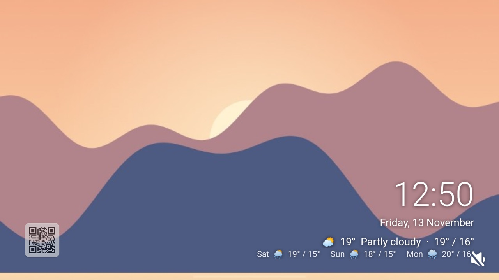
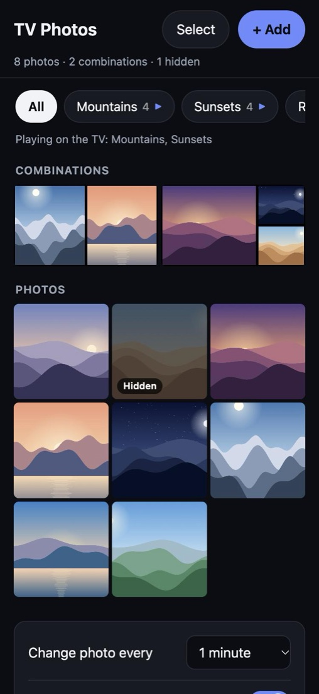
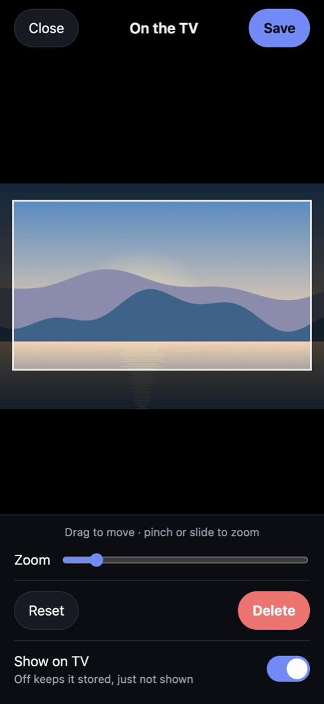
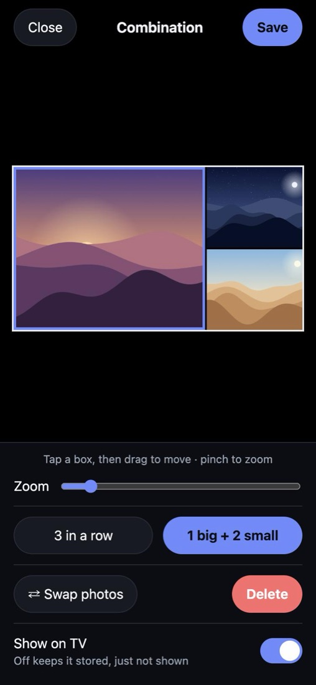
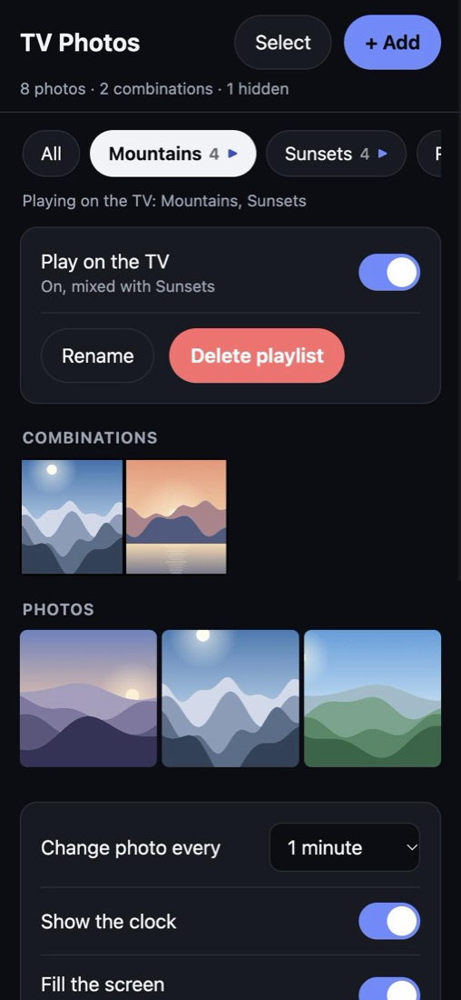
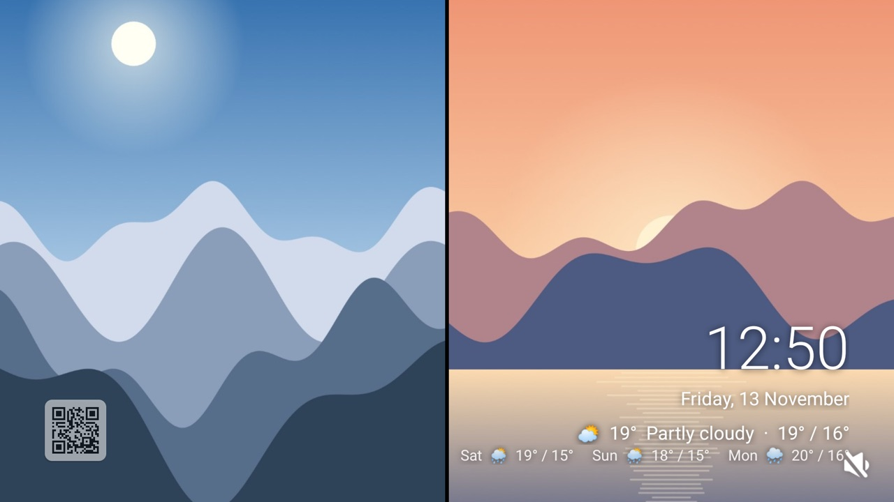
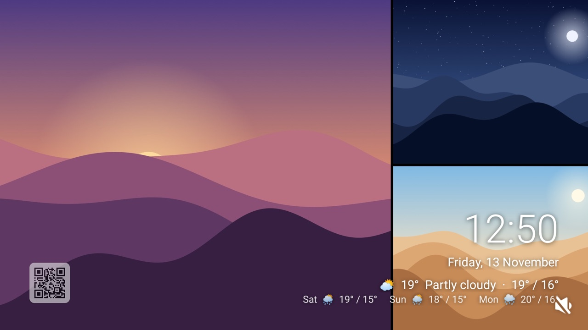
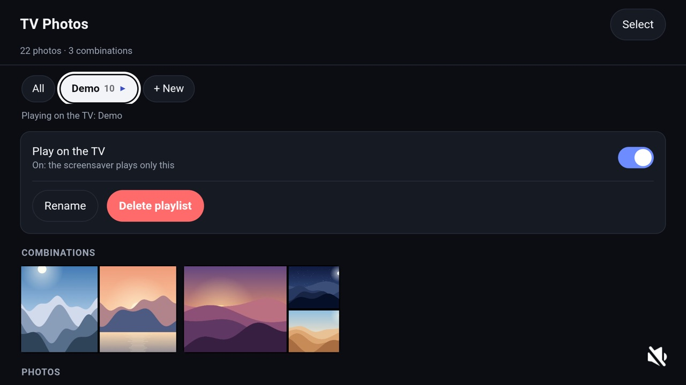
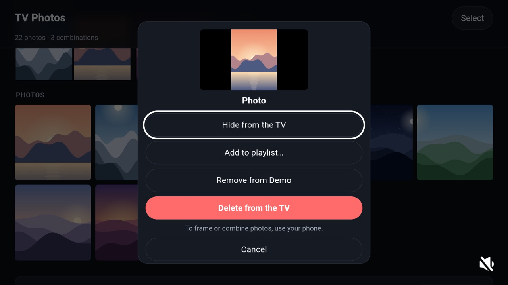

# TV Dynamic Photo Frame

Turn the screensaver of an Android TV or Google TV into a photo frame that you fill from your phone. No
cloud, no account, no app to install on the phone: the TV serves a small page on your home Wi-Fi, and
your photos stay on the TV.

The app is called **TV Photos** on the TV.



## What it does

- **A page on your phone** (any browser, same Wi-Fi, 4-digit PIN): add photos from the gallery (HEIC
  too), delete them, hide them without deleting.
- **Framing:** see exactly how a photo will sit on the 16:9 screen, then drag and zoom it.
- **Combinations:** put 2 to 4 photos on one slide: side by side, 3 in a row, 1 big + 2 small, or a 2 x 2
  grid.
- **Playlists:** *Italy*, *Japan*, *Family*… Switch on the ones to play; several can play at once.
- **The screensaver:** a slow crossfade, a 24-hour clock, the date, the weather in °C, and a faint QR code
  that opens the phone page. **◀ ▶** on the remote go back and forward.
- **The same page on the TV:** manage photos and playlists from the sofa with the remote.

| Photos and playlists | Framing | A combination | A playlist |
|---|---|---|---|
|  |  |  |  |

| Side by side | 1 big + 2 small |
|---|---|
|  |  |

| The page on the TV | A photo, on the TV |
|---|---|
|  |  |

## What you need

- **A TV** with Android TV or Google TV, Android 8.0 or newer. Tested on a Xiaomi TV A Pro 55 2025 (Google
  TV, Android 11). It must use Android's own screensaver: Google TV hides the setting, but the install sets
  it over ADB. TVs that are not Android (Samsung, LG, Roku) cannot run it.
- **A computer** on the same network with `adb` ([Android platform-tools](https://developer.android.com/tools/releases/platform-tools)).
  To build the app: JDK 17 or newer and the Android SDK with platform 34. Android Studio includes both.
- **USB debugging** on the TV, just for the install: Settings > System > About > press OK on **Build**
  7 times; then Settings > System > Developer options > **USB debugging** on. (On some TVs: About is under
  Settings > Device Preferences.)

## Install

### With an AI coding agent

Give your agent (Claude Code, Codex, Gemini CLI, Cursor…) this prompt, with your TV's IP address
(TV Settings > Network & Internet > your network):

```text
Install TV Photos from https://github.com/rickerp/tv-dynamic-photo-frame on my Android TV and make it
the screensaver. Clone the repo and follow its AGENTS.md. My TV's IP address is 192.168.1.50.
```

The agent checks your tools, builds the app, installs it, sets the screensaver and checks the result with
screenshots. It asks you first before anything else, such as installing tools on your computer.

### By hand

```bash
git clone https://github.com/rickerp/tv-dynamic-photo-frame
cd tv-dynamic-photo-frame
./install.sh 192.168.1.50
```

Use your TV's address. The first time, the TV asks **Allow USB debugging?**: choose **Allow**. The script
builds the app, installs it, makes it the screensaver and prints the phone page's address. Run it again
any time to update: photos and settings are kept. `./install.sh usb` works for a TV on a USB cable.

<details>
<summary>Without the script (for example on Windows)</summary>

```bash
./gradlew assembleRelease            # gradlew.bat on Windows; needs ANDROID_HOME or local.properties
adb connect 192.168.1.50:5555
adb install -r app/build/outputs/apk/release/app-release.apk
adb shell am start -n home.tvphotos/.MainActivity
adb shell settings put secure screensaver_components home.tvphotos/.PhotoDream
adb shell settings put secure screensaver_default_component home.tvphotos/.PhotoDream
adb shell settings put secure screensaver_enabled 1
```

</details>

When it is installed, you can switch USB debugging off again.

## First steps

1. **Your PIN:** on the TV, **TV Photos** is open. Choose **New random PIN**: the TV shows it once.
2. **On your phone:** open the address shown on the TV (`http://<tv-ip>:8080`), or scan its QR code.
   Enter the PIN, then **+ Add** photos. In Chrome, menu > *Add to Home screen* gives you an icon.
3. **The weather:** at the bottom of the page, type your town, **Search**, tap it.
4. **Try it:** TV Photos > **Preview screensaver**. The screensaver then starts by itself when the TV is
   idle, after the time in the TV's screen saver settings (their name and place vary by TV). On Google TV
   you can also set it from the computer: `adb shell settings put system screen_off_timeout 300000`
   (5 minutes).

## Using it

### On the phone

- **Tap a photo** to frame it (see below), hide it, or delete it.
- **Select**, tap photos or combinations, then **Combine**, **Hide** / **Show**, **Add to…** a playlist,
  **Remove** from the open playlist, or **Delete**.
- At the bottom: how often the photo changes, the clock, *Fill the screen*, the QR code, the weather town
  and the PIN.

### Framing

The white box is the TV screen; what falls outside it is dimmed, and the TV does not show it. **Drag** to
move the photo; **pinch** (two fingers apart or together) or the **Zoom** slider to zoom, from the whole
photo with black bars up to 4x. **Save**. **Reset** goes back to the default. Photos you never framed
follow *Fill the screen*: on, they fill the screen; off, a photo is shown whole unless it is already close
to the screen's shape. Nothing is cut from the stored photo, so you can change a framing at any time.

### Combinations

1. **Select**, tap 2 to 4 photos in the order you want them, then **Combine**.
2. Pick the layout: 2 photos side by side; 3 in a row, or 1 big + 2 small (the first one is big); 4 in a
   grid.
3. Tap a box, then drag and pinch to frame its photo. **Swap photos** moves every photo one box along.
   **Save**.

A combination is a slide of its own. Its photos still show alone too: hide a photo if you only want it in
the combination. Deleting a photo also deletes the combinations it is in; the page says so first.

### Playlists

The chips at the top: **All**, your playlists, **+ New**.

- **Fill one:** in *All*, **Select** photos or combinations > **Add to…**. Or open the playlist and
  **+ Add**: new photos go straight into it.
- **Take out:** open it > **Select** > **Remove**. The photos stay on the TV.
- **Play on the TV:** each playlist has this switch. The screensaver mixes every playlist that is on (a ▶
  marks them). With none on, every photo plays. If the ones that are on have nothing to show, every photo
  plays too, so the screen is never empty.

### Hiding

*Show on TV* off (tap a photo or combination), or **Select** > **Hide**, keeps it on the TV and on the
page, dimmed with a *Hidden* tag, but the screensaver skips it. Hidden photos stay hidden inside
playlists.

### On the TV

- **In the screensaver:** **◀ ▶** go to the previous and next slide; any other button closes it.
- **TV Photos > Photos & playlists** opens the same page on the TV, signed in. **Arrows** move,
  **OK** presses, **Back** closes what is open. OK on a photo shows it larger with *Hide*, *Add to
  playlist*, *Remove* and *Delete*. Naming a playlist opens the on-screen keyboard. Adding photos, framing
  and combining need the phone.

### The PIN

There is one PIN. It is never displayed, except once right after **New random PIN** (on the TV, or on the
page). Change it on the page: *Change PIN*. Any change signs out every other phone.

## Privacy and security

- Photos stay in the app's private storage on the TV. No other app can read them, and the app needs no
  storage permission.
- The only outside connection is the weather: [Open-Meteo](https://open-meteo.com) (free, no account, no
  key), and only with your town's coordinates. It asks when the screensaver starts and the last forecast
  is over 30 minutes old, then every 30 minutes while it runs, and once when you pick a town.
- The page is plain HTTP on your home network, behind the PIN. After 5 wrong PINs it refuses logins for a
  minute. A 4-digit PIN is easy to guess, so **do not forward port 8080** on your router.
- If the TV's address changes, TV Photos on the TV shows the new one. To keep it fixed, reserve the
  address for the TV in your router's DHCP settings.

## How it works

| Part | What it does |
|---|---|
| `PhotoServer` | A foreground service, started at boot, that serves the page on port 8080 (about 4 MB of memory). |
| `index.html` | The whole page, phone and TV, in one file with no outside resources (`app/src/main/assets/`). It shrinks photos on the phone before sending them. |
| `Store` | Saves each upload upright (EXIF), scaled to fit 1920x1080, plus a thumbnail; the PIN and the settings. |
| `Library` | Framings, Show-on-TV switches, combinations and playlists, in `library.json` next to the photos. |
| `PhotoDream` + `SlideView` | The screensaver (an Android `DreamService`) and the view that draws one slide. |
| `Framing` | Where a photo sits in a box, and each layout's boxes. `index.html` has a line-for-line JavaScript copy, so the editor shows what the TV draws. |
| `Playing` | Which slides play, given the playlists that are on. |
| `ManageActivity` | *Photos & playlists*: the page in a WebView at `http://127.0.0.1:8080/?tv=1`, locked to that address. |
| `Weather` | The Open-Meteo forecast and town search. |
| `Qr` | The QR codes, with [Project Nayuki's QR Code generator](https://www.nayuki.io/page/qr-code-generator-library) (MIT), copied in unchanged. |

No libraries beyond the Android SDK. Design notes for the bigger features are in `docs/specs/` and
`docs/plans/`.

## Build and test

```bash
./gradlew testReleaseUnitTest assembleRelease
```

The APK is `app/build/outputs/apk/release/app-release.apk`, signed with your computer's Android debug key.
An update only installs over a copy signed with the same key, so update from the same computer, or
uninstall first (which deletes the photos on the TV).

Contributions are welcome: [AGENTS.md](AGENTS.md) has the rules, for people and AI agents alike.

## Turn it off or remove it

- **Another screensaver:** TV Settings > System > Ambient mode or Screen saver. On Google TV, over ADB:
  `adb shell settings put secure screensaver_components com.google.android.apps.tv.dreamx/.service.Backdrop`.
- **Remove the app and its photos:** TV Settings > Apps > TV Photos > Uninstall, or
  `adb uninstall home.tvphotos`. The photos on your phone are not touched.

## Credits and licence

MIT licence, see [LICENSE](LICENSE). QR codes by [Project Nayuki](https://www.nayuki.io/page/qr-code-generator-library)
(MIT). [Weather data by Open-Meteo.com](https://open-meteo.com/) (CC BY 4.0). The demo pictures in the
screenshots are drawn by code; no real photos.
